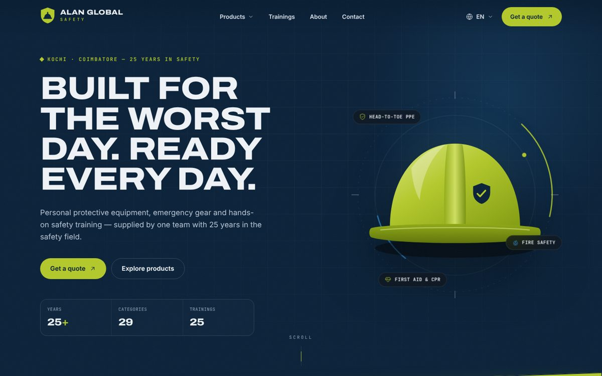
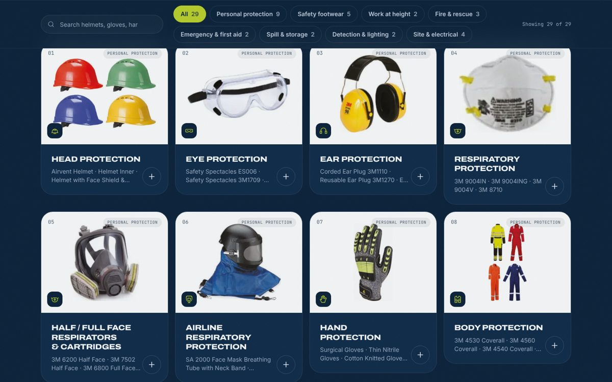
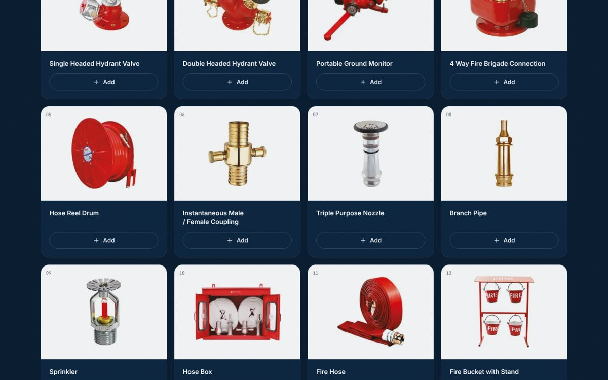
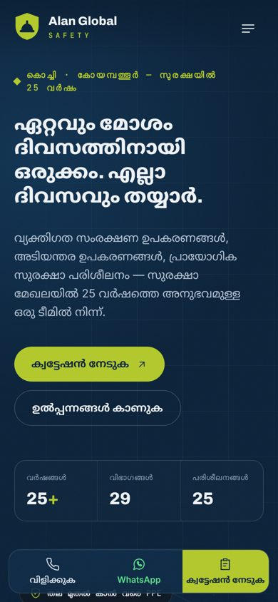

# Alan Global Safety — website

Marketing site and catalogue for **Alan Global Safety**, a safety-equipment supplier and in-house training provider in Kochi (Kakkanad) and Coimbatore. The site is static: all 61 pages are prerendered at build time and served from Vercel, with no backend.



| Catalogue | Section page | Phone (Malayalam) |
| --- | --- | --- |
|  |  |  |

## What's inside

- **Product catalogue**: 298 products in 29 sections, taken from the company brochure (`AGS Global Safety` PDF). Each product has its photo from the brochure, a search box per section and an *Add to quote* button.
- **25 training programmes** (ATP1–ATP25), with filters, a page per programme and a *Book this training* button.
- **Quote list**: products and trainings are collected in the visitor's browser and sent in one go. Sending opens WhatsApp with the message written out, and also emails a copy through Web3Forms once a key is configured.
- **Three languages**: English, Malayalam and Tamil. Brand and model names stay as printed in the brochure.
- **About and Contact**: company profile from the brochure, both offices with directions, a contact form and a map.
- **Search engines**: page titles and descriptions per language, canonical links, Open Graph image, JSON-LD (Organization, LocalBusiness for both offices, Course, BreadcrumbList), `sitemap.xml` and `robots.txt`.

## Stack

| | |
| --- | --- |
| Framework | Angular 20 — standalone components, signals, zoneless, static prerendering |
| Styling | Tailwind CSS 4 with design tokens in `src/styles.css` (brochure navy `#103B61` and lime `#B3C92B`) |
| Motion | GSAP (ScrollTrigger, SplitText, Flip) and Lenis smooth scrolling, loaded only in the browser and skipped when the visitor prefers reduced motion |
| i18n | `@ngx-translate` with JSON files in `src/i18n` |
| Tests | Karma + Jasmine in headless Chrome |
| Hosting | Vercel (`vercel.json`), CI on GitHub Actions |

## Getting started

Requires Node 22.

```bash
npm ci
npm start          # http://localhost:4200
npm run build      # prerendered site in dist/alan-global-safety/browser
npm test           # unit tests (watch mode)
npm run test:ci    # unit tests once, headless
```

`npm run build` first runs `scripts/prebuild.mjs`, which writes the site URL into `src/app/core/site-url.ts` and regenerates `public/sitemap.xml` and `public/robots.txt` from the routes, product sections and training programmes.

## Where things live

| Change | File |
| --- | --- |
| Phone numbers, emails, addresses, offices, years of experience, WhatsApp number | `src/app/core/company.config.ts` |
| Product sections (order, group, icon, cover photo) | `src/app/core/company.config.ts` → `PRODUCT_CATEGORIES` |
| Products in each section (name, photo) | `src/app/core/catalog.data.ts` and `public/images/catalog/<section>/` |
| Training programmes | `src/app/core/trainings.config.ts`; text in `src/i18n/*.json` under `trainings.programmes` |
| Any visible text | `src/i18n/en.json`, `ml.json`, `ta.json` (keep the three files in step — a unit test checks this) |
| Colours, fonts, buttons | `src/styles.css` |

**Adding a product**: put a photo at `public/images/catalog/<section>/<id>.webp`, add `it('<section>', '<id>', '<Name as printed>', width, height)` to `catalog.data.ts`, and optionally add a translated name under `products.items.<section>.<id>` in `ml.json` and `ta.json` (with the English name in `en.json`).

## Before going live

- [ ] **Web3Forms key**: create a free access key at web3forms.com for the company inbox and set `web3formsKey` in `company.config.ts`. Until then, enquiries are sent by WhatsApp only.
- [ ] **Custom domain**: add it in Vercel, then set the `SITE_URL` environment variable (e.g. `https://alanglobalsafety.com`) so canonical links and the sitemap use it.
- [ ] **Client review**: CEO message wording on the About page, the four division descriptions, and the training topics for ATP25.
- [ ] **Google Search Console**: submit `https://<domain>/sitemap.xml`.

## Deploying

1. Push to GitHub. CI runs the unit tests and a full build on every push and pull request.
2. In Vercel, *Add New → Project*, import the repository. `vercel.json` already sets the install and build commands and the output folder; no framework preset is needed.
3. Every push to `main` deploys to production; pull requests get preview URLs.

## Quality checks done

- Unit tests: catalogue integrity (every section has products and a cover photo from its own products), translation parity across the three languages, quote list behaviour, phone validation, message building.
- Accessibility: axe-core (WCAG 2.2 AA + best practice) on desktop and phone for the main page types — no violations.
- Layout: no horizontal scrolling at 320, 390 and 768 px in all three languages.
